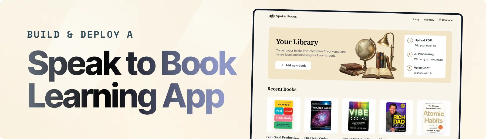

<div align="center">
  <br />
  
  <br />

  <div>
    
    
    
    
    
    
    
    
  </div>

  <h1 align="center">Bookified</h1>

  <p align="center">
    <strong>AI-Powered Conversational Book Companion</strong><br />
    Turn books and PDF documents into interactive voice companions with real-time conversational AI.
  </p>
</div>

---

## 📋 Table of Contents

1. [Overview](#-overview)
2. [Key Features](#-key-features)
3. [Tech Stack](#-tech-stack)
4. [Getting Started](#-getting-started)
5. [Environment Variables](#-environment-variables)
6. [Project Structure](#-project-structure)
7. [Contributing & License](#-license)

---

## 💡 Overview

**Bookified** transforms reading into an active, spoken dialogue. Upload your PDF books, and Bookified parses the text, extracts structural segments, and attaches an intelligent conversational AI assistant. Using low-latency voice synthesis and recognition, you can discuss plotlines, debate ideas, test your comprehension, and ask questions out loud as if speaking directly to a personal tutor or the book itself.

---

## 🔋 Key Features

- **📖 PDF Processing & Ingestion**: Upload custom PDF books with automatic page-by-page text extraction, segment chunking, and metadata storage.
- **🎙️ Real-Time Voice Conversations**: Low-latency, full-duplex verbal discussions powered by the Vapi conversational voice stack.
- **🗣️ Natural Voice Personas**: Multiple lifelike ElevenLabs voice personalities (Dave, Daniel, Chris, Rachel, Sarah) tailored for conversational dynamics.
- **📝 Live Transcripts**: Real-time speech-to-text transcript generation alongside vocal feedback, ensuring you never miss a detail.
- **🔍 Smart Content Retrieval**: Fast keyword and content search across book segments using MongoDB text indexing.
- **🔐 Secure Authentication & Subscriptions**: Comprehensive authentication and multi-tier usage plans powered by Clerk.
- **☁️ Cloud Storage**: Reliable storage for book PDFs and generated cover art with Vercel Blob.

---

## ⚙️ Tech Stack

| Technology | Purpose |
| :--- | :--- |
| **Next.js 16 (App Router)** | Full-stack React framework with server actions and streaming |
| **TypeScript** | Strict type safety and robust developer tooling |
| **Tailwind CSS & Shadcn UI** | Accessible, responsive, and modern user interface components |
| **MongoDB & Mongoose** | Document database storing library metadata, segments, and sessions |
| **Clerk** | Authentication, user management, and subscription tiering |
| **Vapi AI** | Orchestration of conversational voice agents and tool calls |
| **ElevenLabs** | Ultra-realistic, low-latency text-to-speech voice models |
| **Vercel Blob** | Fast, secure cloud asset storage for PDFs and book covers |

---

## 🚀 Getting Started

### Prerequisites

Ensure you have the following installed:
- [Node.js](https://nodejs.org/) (v18.18 or higher recommended)
- [npm](https://www.npmjs.com/) or [pnpm](https://pnpm.io/)
- [Git](https://git-scm.com/)

### 1. Clone the Repository

```bash
git clone https://github.com/PriyanshuCosmos/Bookified.git
cd Bookified
```

### 2. Install Dependencies

```bash
npm install
```

### 3. Configure Environment Variables

Create a `.env.local` file in the root directory by copying the template:

```bash
cp .env.example .env.local
```

Fill in the required credentials as described in the [Environment Variables](#-environment-variables) section below.

### 4. Run the Development Server

```bash
npm run dev
```

Open [http://localhost:3000](http://localhost:3000) in your browser.

---

## 🔑 Environment Variables

The project requires the following environment variables:

```env
# Application Environment
NODE_ENV=development
NEXT_PUBLIC_BASE_URL=http://localhost:3000

# Clerk Authentication & User Management
NEXT_PUBLIC_CLERK_PUBLISHABLE_KEY=pk_test_...
CLERK_SECRET_KEY=sk_test_...
NEXT_PUBLIC_CLERK_SIGN_IN_URL=/sign-in
NEXT_PUBLIC_CLERK_SIGN_UP_URL=/sign-up
NEXT_PUBLIC_CLERK_SIGN_IN_FALLBACK_REDIRECT_URL=/
NEXT_PUBLIC_CLERK_SIGN_UP_FALLBACK_REDIRECT_URL=/

# MongoDB Database Connection
MONGODB_URI=mongodb+srv://<username>:<password>@cluster.mongodb.net/bookified?retryWrites=true&w=majority

# Vapi Conversational Voice AI
NEXT_PUBLIC_VAPI_API_KEY=vapi_public_...
NEXT_PUBLIC_ASSISTANT_ID=asst_...
VAPI_SERVER_SECRET=vapi_secret_...

# Vercel Blob Storage
BLOB_READ_WRITE_TOKEN=vercel_blob_rw_...
```

### Variable Details:

| Variable | Description | Where to get |
| :--- | :--- | :--- |
| `NEXT_PUBLIC_CLERK_PUBLISHABLE_KEY` | Public key for frontend auth components | [Clerk Dashboard](https://dashboard.clerk.com) > API Keys |
| `CLERK_SECRET_KEY` | Backend secret key for server-side auth | [Clerk Dashboard](https://dashboard.clerk.com) > API Keys |
| `MONGODB_URI` | MongoDB connection URI for database operations | [MongoDB Atlas](https://cloud.mongodb.com) > Connect Cluster |
| `NEXT_PUBLIC_VAPI_API_KEY` | Public API key used by the web client to start calls | [Vapi Dashboard](https://dashboard.vapi.ai) > API Keys |
| `NEXT_PUBLIC_ASSISTANT_ID` | Identifier of your configured Vapi Assistant | [Vapi Dashboard](https://dashboard.vapi.ai) > Assistants |
| `VAPI_SERVER_SECRET` | Secret key used for authenticating Vapi server requests | [Vapi Dashboard](https://dashboard.vapi.ai) > Account Settings |
| `BLOB_READ_WRITE_TOKEN` | Token for uploading book PDFs and cover thumbnails | [Vercel Storage](https://vercel.com/dashboard/stores) > Create Blob Store |

---

## 📁 Project Structure

```
├── app/                  # Next.js App Router (pages and API routes)
│   ├── (root)/           # Main application routes (books, subscriptions)
│   ├── api/              # API endpoints (blob upload, Vapi search-book tool)
│   └── layout.tsx        # Root layout with Clerk and Sonner providers
├── components/           # Reusable React components & Shadcn UI elements
│   ├── ui/               # Core design system primitives (buttons, dialogs, etc.)
│   ├── BookCard.tsx      # Book display card component
│   ├── FileUploader.tsx  # Drag-and-drop file upload component
│   ├── UploadForm.tsx    # PDF processing and submission workflow
│   ├── VapiControls.tsx  # Voice session control bar
│   └── VoiceSelector.tsx # ElevenLabs persona selector
├── database/             # MongoDB schemas & Mongoose client connection
│   └── models/           # Mongoose schemas (Book, BookSegment, VoiceSession)
├── hooks/                # Custom hooks (useVapi, useSubscription)
├── lib/                  # Utilities, actions, validation schemas, and constants
└── public/               # Static icons, vector graphics, and illustrations
```

---

## 📄 License

This project is licensed under the [MIT License](LICENSE).
